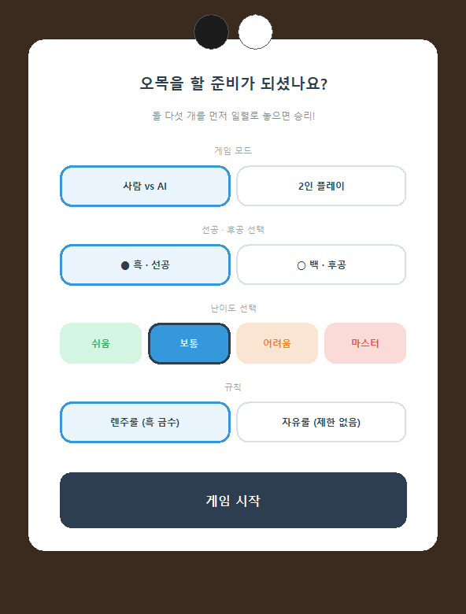
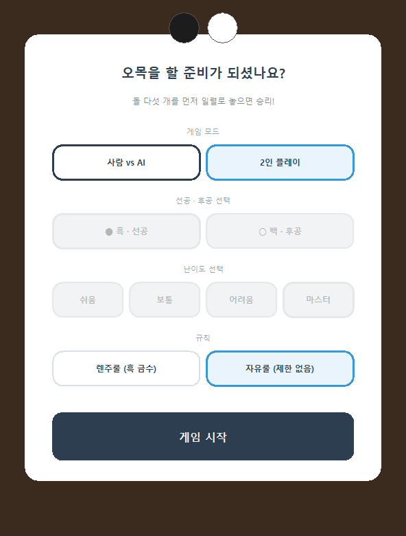
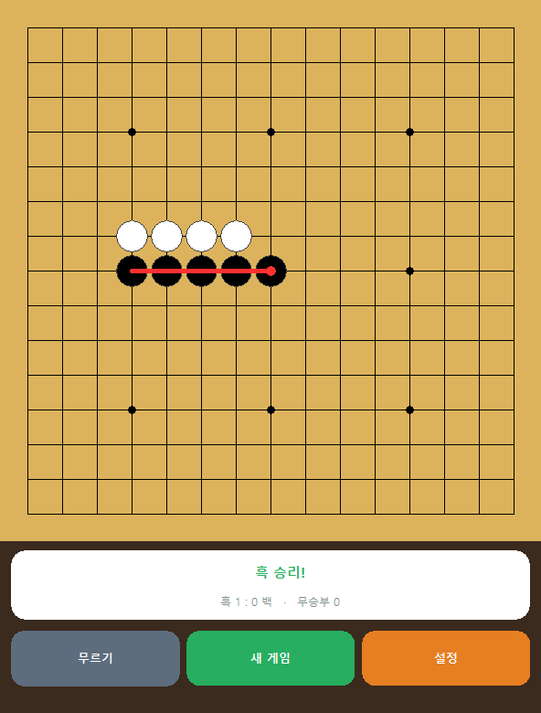
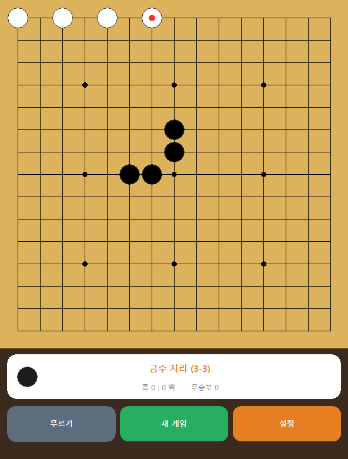

# Omok (Player vs AI / 2인 플레이)

LabVIEW로 만든 15×15 오목 게임입니다. `Omok.lvproj`를 열고 `Omok_Main.vi`를 실행하세요.
창 전체가 **2D Picture 한 장**으로 그려지는 모바일 게임 스타일 UI이며, 모든 조작은 마우스 클릭입니다.

| 설정 화면 | 2인 플레이 선택 시 | 게임 화면 (흑 승리) | 금수 안내 |
|---|---|---|---|
|  |  |  |  |

## 기능

- **설정 화면** (실행 시 첫 화면)
  - 게임 모드: 사람 vs AI / 2인 플레이
  - 선공·후공: ● 흑·선공 / ○ 백·후공 (AI 대전에서만, 2인 플레이는 흑 선공 고정이라 회색 비활성)
  - 난이도: 쉬움 / 보통 / 어려움 / 마스터 (AI 대전에서만)
  - 규칙: 렌주룰(흑 3-3·4-4·장목 금지) / 자유룰
  - **게임 시작** → 오목판 화면으로 전환 (점수 초기화)
- **게임 화면**
  - 오목판(마우스를 올리면 놓일 자리 미리보기, 마지막 수 빨간 점, 승리 5목 빨간 선)
  - 상태 카드: 차례 돌 아이콘, 상태 문구(차례/승리/금수/무승부), 점수 (AI 대전: 플레이어 : AI, 2인: 흑 : 백, 무승부)
  - 버튼: **무르기**(2인 1수, AI 대전은 내 차례까지 1~2수) / **새 게임**(점수 유지) / **설정**(설정 화면으로)
- 버튼에 마우스를 올리면 진한 테두리로 강조, 선택된 항목은 색으로 표시
- 창을 닫으면 세 루프가 모두 정상 종료

## 구조

```
UI 이벤트 루프 ──(게임 큐: Click/Hover + 좌표)──> 게임 루프 ──(AI 큐)──> AI 작업 루프
  Board: Mouse Down / Mouse Move / Panel Close?      Context(Shift Register 1개)      AI_Calculate_Move
                     <──────────────────(게임 큐: AI Move Ready + Game ID)──────────────────┘
```

- 게임 상태는 `Context` 클러스터 하나(화면, 설정, 바둑판, 상태, Game ID, 호버, 점수, 문구)로 관리합니다.
- 게임 루프: `Game_Click` / `Game_Hover` / `Game_AI_Move` 로 Context 갱신 → 필요하면 AI 요청 → `UI_Render` 로 다시 그리기
  (마우스 이동은 호버 대상이 바뀔 때만 다시 그림)
- 새 게임·무르기·설정으로 나가면 Game ID가 바뀌어, 계산 중이던 AI 결과는 버려집니다.

## 폴더

| 폴더 | VI | 내용 |
|---|---|---|
| `/` | `Omok_Main.vi` | 메인 VI (창 설정, 이벤트 + 큐 3루프) |
| `UI/` | `UI_Render` | Context → 화면 전체 Picture (설정 화면 / 게임 화면) |
| | `UI_Draw_Buttons`, `UI_Hit_Test` | 버튼 배치표(Specs)를 둥근 버튼으로 그리기 / 클릭 좌표 → 버튼 찾기 |
| | `UI_Settings_Layout`, `UI_Game_Layout` | 화면별 버튼·글자 배치표 (그리기와 클릭 판정이 같은 표 사용) |
| | `UI_Draw_Board`, `UI_Pixel_To_Grid`, `UI_Board_Geometry` | 오목판 그리기, 좌표 → 칸 |
| `Game/` | `Game_Click`, `Game_Hover`, `Game_AI_Move` | 마우스 클릭 / 이동 / AI 결과 처리 |
| | `Game_Start`, `Game_Board_Click`, `Game_Undo_Move` | 새 판, 바둑판 착수(2인/AI), 무르기 |
| | `Game_Place_Stone`, `Game_Undo` | 착수 검사·승패 판정, 기록 되돌리기 |
| `AI/` | `AI_Calculate_Move` 외 4개 | 후보(반경 2) → 패턴 점수 → 정렬 → 2수 탐색 |
| `Rules/` | 3개 | 연속 수, 5목 판정, 렌주 금수 |
| `Typedefs/` | 12개 `.ctl` | 1차 설계 때 만든 형 정의 (v2 Context는 리터럴 타입) |
| `Tests/` | `Test_Flow`, `Test_Render`, `Test_AI`, `Test_Game`, `Test_Rules`, `Test_Draw` | 단위·흐름 테스트 |
| `src/`, `tools/` | | AIXML 원본, 생성 스크립트 |

## AI 난이도

| 난이도 | 방식 |
|---|---|
| 쉬움 | 공격 + 0.6×수비 + 큰 난수 |
| 보통 | 공격 + 0.9×수비 (탐욕) |
| 어려움 | 상위 6수 × 상대 최선 응수 (2수 탐색) |
| 마스터 | 상위 12수 × 상대 최선 응수 (2수 탐색) |

## 테스트 결과

`Tests/Test_Flow.vi`에 클릭 좌표 배열을 넣어 실제 게임 흐름을 검증했습니다.
- AI 대전: 게임 시작 → 착수 → AI 응수, 4수 진행 후 "당신 차례"
- 2인 플레이: 흑 5목 → "흑 승리!", 흑 점수 1, 승리 라인 표시
- 2인 플레이 무르기: 3수 후 무르기 → 2수, "흑 차례"
- 백·후공 + 마스터: AI(흑) 첫 수 (7,7) → 설정 버튼으로 복귀, 설정값 유지
- 2인 플레이에서 난이도 클릭 무시(비활성)
- 렌주룰 2인 플레이: 흑 3-3 자리 → "금수 자리 (3-3)", 착수 거부
- 실제 실행: 설정 화면 클릭, 게임 시작, 착수, 무르기, 창 닫기 종료까지 확인

## 다시 생성하기

```bash
cd tools
python3 gen_rules.py ../src; python3 gen_ui.py ../src; python3 gen_ui2.py ../src
python3 gen_ai.py ../src; python3 gen_game.py ../src; python3 gen_game2.py ../src
python3 gen_main2.py ../src
```

SubVI를 부르는 VI는 생성 시점에 그 SubVI가 LabVIEW에 열려 있어야 합니다(프로젝트를 통해 `lvai_open_file`).
`Omok_Main.xml`은 이벤트 구조가 있으므로 `lvai_generate_vi_with_events`로 변환합니다.

## 참고

- 일부 SubVI의 블록 다이어그램은 1920×1080보다 넓습니다(특히 `Omok_Main`, `UI_Render`, `Game_Board_Click`).
- 렌주 금수 판정은 연속된 돌만 봅니다(띈 3/띈 4 미포함).
