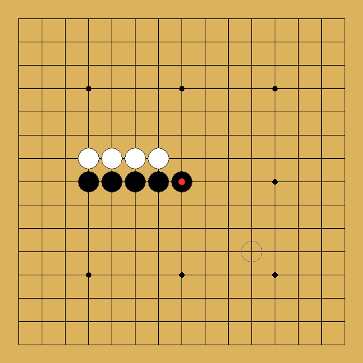
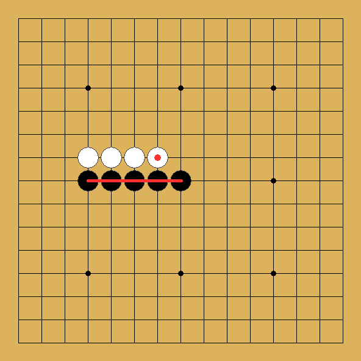

# Omok (Player vs AI)

LabVIEW로 만든 15×15 오목 게임입니다. 플레이어와 AI가 대국하며, 렌주룰 흑 금수(3-3, 4-4, 장목)를 지원합니다.
`Omok.lvproj`를 열고 `Omok_Main.vi`를 실행하세요.

 

## 구조

메인 VI는 큐 두 개로 연결된 루프 3개로 되어 있습니다(QMH / Producer-Consumer).

```
UI 이벤트 루프 ──(게임 큐: Game_Message)──> 게임 루프 ──(AI 큐: AI_Request)──> AI 작업 루프
   마우스/버튼                               상태 = Shift Register                    AI_Calculate_Move
                     <──────────────(게임 큐: AI Move Ready)──────────────────────────┘
```

- **UI 이벤트 루프**: Board Mouse Down / Mouse Move, New Game, Undo, Exit, Panel Close? 이벤트를 메시지로 보냅니다.
- **게임 루프**: Board State, 게임 상태, Game ID, 승패 카운터를 Shift Register로 들고 메시지를 처리합니다. 처리할 때마다 바둑판을 다시 그립니다.
- **AI 작업 루프**: 착수 계산이 UI를 막지 않도록 따로 돕니다. 결과에 Game ID를 붙여 보내고, 새 게임이나 무르기 이후 도착한 지난 결과는 게임 루프가 버립니다.

## 폴더

| 폴더 | VI | 내용 |
|---|---|---|
| `/` | `Omok_Main.vi` | 메인 VI (이벤트 구조 + 큐 3루프) |
| `Rules/` | `Rule_Count_Direction`, `Rule_Check_Win`, `Rule_Check_Forbidden` | 방향별 연속 수, 5목 판정, 렌주 금수 판정 |
| `UI/` | `UI_Board_Geometry`, `UI_Pixel_To_Grid`, `UI_Draw_Board` | 바둑판 치수(원점 30 px, 칸 38 px, 592 px), 마우스 좌표 → 칸, 2D Picture 그리기 |
| `AI/` | `AI_Get_Candidates`, `AI_Evaluate_Point`, `AI_Score_Candidates`, `AI_Lookahead`, `AI_Calculate_Move` | 후보 수(반경 2), 패턴 점수, 정렬, 2수 탐색, 난이도별 착수 |
| `Game/` | `Game_Place_Stone`, `Game_Undo` | 착수(검사 + 승/무 판정), 무르기 |
| `Typedefs/` | 12개 `.ctl` | Stone, Move, Board_State, Difficulty, Game_Status, Msg_Type 등 |
| `Tests/` | `Test_Rules`, `Test_Draw`, `Test_AI`, `Test_Game` | 단위 테스트 VI |
| `src/` | `*.xml` | 각 VI의 AIXML 원본 |
| `tools/` | `*.py` | AIXML 생성 스크립트 (`lib.py` 공용) |

## AI

| 난이도 | 방식 |
|---|---|
| Easy | 공격 + 0.6×수비 점수 + 큰 난수 |
| Normal | 공격 + 0.9×수비 점수 (탐욕) |
| Hard | 상위 6수 각각에 대해 상대 최선 응수 점수×0.8을 뺀 값이 최대인 수 (2수 탐색) |

칸 점수는 4방향 연속 길이와 열린 끝 수로 매깁니다: 5목 100000, 열린4 10000, 닫힌4·열린3 1000, 닫힌3·열린2 100 …

## 테스트 결과

- 규칙: 5목, 4목, 장목, 렌주 흑 장목, 3-3, 4-4, 백 대각선, 렌주 OFF — 8개 모두 정상
- AI: 상대 열린 4 차단, 자기 4 완성, 빈 판 천원(7,7), 열린 3 차단 — Normal 약 0.1초, Hard 약 0.2초
- 착수/무르기: 같은 칸 거부, 3-3 금수 거부, 2수/전체 무르기 정상
- 메인 VI: AI 선공(플레이어 백), 무르기 시 AI 첫 수 유지, New Game, Exit 후 정상 종료
- 마우스 클릭/호버는 자동 테스트로 확인하지 못했습니다(실제 화면에서 확인 필요).

## 설계서와 다른 점

- Hard는 알파-베타 대신 상위 6수 2수 탐색으로 단순화했습니다.
- 금수 판정은 연속된 돌만 봅니다(띈 3, 띈 4 미포함).
- 수식 노드를 쓰지 않고 G 코드로 구현했습니다.
- 큐 원소와 컨트롤은 typedef(.ctl)와 같은 구조의 리터럴 타입이며, .ctl에 연결되어 있지 않습니다.
- `Omok_Main.vi` 블록 다이어그램이 넓습니다(약 11,000 px). 메시지 처리 프레임을 SubVI로 나누는 정리가 남아 있습니다.

## 다시 생성하기

```bash
cd tools
python3 gen_rules.py ../src
python3 gen_ui.py ../src
python3 gen_ai.py ../src
python3 gen_game.py ../src
python3 gen_main.py ../src
```

SubVI를 부르는 VI는 생성 시점에 그 SubVI가 LabVIEW에 열려 있어야 합니다(프로젝트를 통해 `lvai_open_file`).
`Omok_Main.xml`은 이벤트 구조가 있으므로 `lvai_generate_vi_with_events`로 변환합니다.
