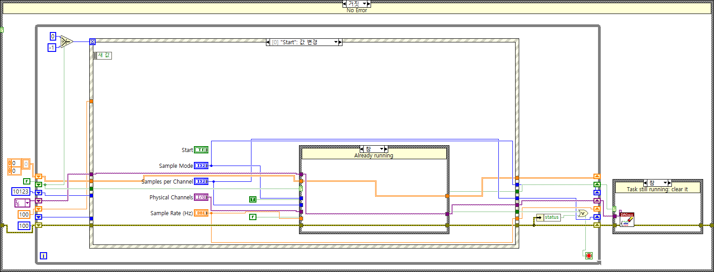
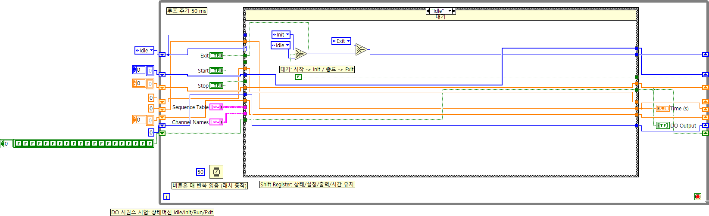

# LabviewTest

LabVIEW MCP(AIXML)로 생성한 LabVIEW 2026 VI 모음입니다.
각 VI는 AIXML 원본(`.xml`)에서 생성되었으며, `tools/`의 Python 스크립트로 AIXML을 다시 만들 수 있습니다.

> LabVIEW 2026 (32-bit, 한국어) 환경에서 생성·검증했습니다. 커넥터 팬 패턴은 4833입니다.

## 구성

| 폴더 | VI | 내용 |
|---|---|---|
| `Scale_4to20mA/` | `Scale_4to20mA.vi` | 4~20 mA → 0~100 % 스케일링 SubVI, 상한/하한 알람 출력 |
| `AI_Data_Tdms/` | `AI_Data_Tdms.vi` | NI 9203 8ch 전류 측정(DAQmx), 채널별 스케일 변환, 차트 표시, TDMS 저장 |
| `DO_Test/` | `DO seq.vi` | 시퀀스 테이블 기반 64ch DO 출력 시험 (상태머신 구조) |
| `DO_Test/` | `DO seq_event.vi` | 위와 같은 기능의 이벤트 구조 버전 (백업) |
| `Omok/` | `Omok_Main.vi` 외 19개 | 오목 Player vs AI (이벤트 + 큐 3루프 QMH, 렌주룰, 난이도 3단계) — [상세](Omok/README.md) |
| `tools/` | — | AIXML 생성 스크립트 |

### Scale_4to20mA.vi
- 입력: `Current_mA`, `High_Limit_Pct`, `Low_Limit_Pct`, `error in`
- 출력: `Scaled_Pct`, `High_Alarm`, `Low_Alarm`, `error out`
- `Scaled_Pct = (Current_mA - 4) / 16 * 100`, error in에 오류가 없을 때만 연산합니다.

### AI_Data_Tdms.vi
- While Loop + 이벤트 구조 (Start / Stop / Save Data / Timeout / Panel Close)
- Start: AI 전류 채널(0~20 mA) 생성, 샘플 클럭(유한/연속) 설정 후 시작
- Timeout: `DAQmx Read (2D DBL)` → 채널별 `Min + (I[mA]-4)/16*(Max-Min)` 스케일 → 차트 + 버퍼 누적
- Save Data: 파일 대화상자로 경로/이름 지정 후 TDMS 저장 (그룹 `AI Data`, 채널 `CH0..CHn`)
- 기본 채널 `cDAQ1Mod1/ai0:7` — MAX에 표시되는 실제 모듈 이름으로 바꿔서 사용하세요.



### DO seq.vi (상태머신)
- 상태: `Idle` → `Init` → `Run` → (`Idle` / `Exit`)
- Init: 시퀀스 테이블 1열 채널 이름을 Channel Names(DO00~DO63)에서 검색해 인덱스(0 기준)를 구하고, 2열 On Time / 3열 Off Time을 숫자로 변환
- Run: 50 ms마다 경과 시간 갱신, `On Time <= Time < Off Time` 동안 해당 채널 ON
- 가장 큰 Off Time 도달 시 자동 정지, Stop으로 중간 정지, Start 재입력 시 초기화 후 재시작, Exit로 종료



## AIXML 다시 생성하기

```bash
cd tools
python3 gen_DO_seq.py "DO seq.xml"          # 상태머신 버전
python3 gen_DO_seq_event.py "DO seq.xml"    # 이벤트 구조 버전
python3 gen_AI_Data_Tdms.py AI_Data_Tdms.xml
```

생성한 `.xml`은 LabVIEW MCP의 `lvai_generate_vi`(이벤트 구조가 있으면 `lvai_generate_vi_with_events`)로 VI로 변환합니다.
한국어 LabVIEW는 문자열을 CP949로 저장하므로, 스크립트는 한글 주석을 CP949 바이트로 변환해 넘깁니다.

## 참고
- `.vi` 파일은 LabVIEW에서 저장한 최신본입니다. 생성 후 LabVIEW에서 다시 저장했다면 `.xml` 원본과 패널 배치 등이 다를 수 있습니다.
- `Scale_4to20mA.xml`은 직접 작성한 AIXML입니다(생성 스크립트 없음).
